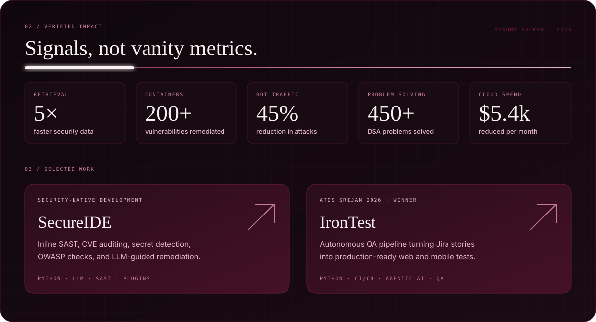
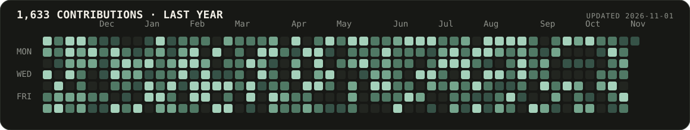

  

  

  

## Experience

**Zepto — Software Engineer Intern, Security** · *May 2026 – Present* 
Building internal security infrastructure for real-time WAF analysis, asset inventory, and cloud visibility. Improved
security-data retrieval by **5×**, contributed to remediating **200+ container vulnerabilities**, and developed an
autonomous SOC triage workflow integrated with Slack.

**Lupin Limited — Software Engineer Intern, Cloud Security** · *Dec 2025 – Jan 2026* 
Built a security-focused small language model and an IDE vulnerability-detection plugin. Improved AWS resource
utilization by **44%** and reduced cloud spend by **$5,400 per month**.

**Hobbiate — Software Engineer Intern** · *May – Aug 2025* 
Shipped production improvements across identity, APIs, and backend services, including an OTP verification redesign
that reduced end-to-end verification time by **62%**.

## Stack and capabilities

**Languages** · `Python` `Go` `Java` `C++` `C` `JavaScript` `SQL` `Bash` `PowerShell` 
**Cloud and containers** · `AWS` `Azure` `Docker` `Kubernetes` `Linux` `IaC security` 
**Security** · `WAF` `SAST` `OWASP Top 10` `MITRE ATT&CK` `KQL` `Penetration testing` `Secrets management` 
**Backend and data** · `Node.js` `REST` `GraphQL` `PostgreSQL` `MongoDB` `Supabase` `Prisma` 
**Applied AI** · `LLM integration` `RAG pipelines` `Agentic AI` `Azure OpenAI` `Vector embeddings`

## GitHub activity

  

  

  

